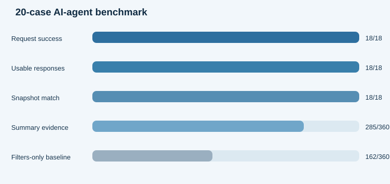

# Official AI-agent benchmark

This is the project's single official Part 5 benchmark. It evaluates the existing smolagents workflow through the existing Render `POST /analyze` endpoint; it does not modify the backend or use a second LLM judge.

## Reproduce

Requirements are the standard library only. The bundled `mental_health_cdi.csv` is the reference snapshot used for independent calculations.

```bash
python agent_benchmark.py --dry-run
python agent_benchmark.py
```

Set `RENDER_API_BASE` to point to the existing service if needed. The harness accepts `--api-base`, `--resume`, and `--outdir`. It sends the 20 fixed inputs in `agent_benchmark_cases.json` and records each result immediately. The endpoint and request schema are the same ones used by the Streamlit app. The full request/response results, case-level CSV, human-review CSV, aggregate JSON, and SVG are checked in here.

## Scoring rules

The fixed cases cover common questions, locations and demographic strata, multiple year ranges, sparse records, missing years, no-numeric-value results, an unmatched demographic filter, and missing location input.

- **Request success:** HTTP 2xx for the 18 valid analysis cases.
- **Usable result:** successful parse with usable explanation and structured response for those 18 cases.
- **Structured snapshot match:** compare returned annual means and year/coverage information to independent calculations from the included CDC Mental Health subset. Means use a 0.005 tolerance. Not applicable to invalid-input cases.
- **Edge validation:** the two invalid cases should be rejected with a 4xx response.
- **Summary evidence coverage:** 20 deterministic evidence criteria per valid case; report numerator and denominator. These are evidence-presence checks, not human-rated semantic accuracy.
- **Latency:** elapsed time per request, with median and 95th percentile across all 20 calls.

The existing filters-only baseline knows the submitted filters and can satisfy 9 of the 20 summary criteria, but it has no retrieved CDC evidence. It is comparable only for summary-evidence coverage: 162/360 (45%) across the 18 valid cases. It is not a baseline for API success, data correctness, usability, or latency.

## Recorded run

Run completed 2026-11-22 UTC against the existing Render service using the bundled snapshot (SHA-256 `49996ab4123f35185ef53d2d4d3d1c3562f8e214ec5a699e4c04bef4955653a4`).

| Measure | Result |
|---|---:|
| Fixed scenarios | 20 |
| Valid analysis requests succeeded with usable results | 18/18 |
| Independent structured snapshot comparisons matched | 18/18 |
| Expected invalid-input rejections | 2/2 |
| Summary evidence criteria | 285/360 (79.2%) |
| Filters-only evidence baseline | 162/360 (45.0%) |
| API latency, median / p95 | 11.405s / 14.902s |



### Examples and follow-up

- **Successful structured case:** A01 (North Carolina and U.S. adult depression, 2019–2023): usable response, independent values and coverage matched, 15/20 summary evidence checks passed.
- **Lowest evidence-coverage case:** A17 (North Carolina postpartum depression, 2020–2022): the result had zero numeric values and its structured no-value/coverage data matched the snapshot, but only 11/20 summary checks passed. This shows the summary checks need explicit handling for a valid result with no numeric estimate.
- **Next improvements:** Make no-numeric-value explanations explicitly state that no annual numeric comparison is available and avoid suggesting a trend; have a human review the flagged summary criteria, distinguish genuine omissions from valid paraphrases, and refine the deterministic scoring rules.

Human semantic accuracy review is **pending**. A deterministic evidence match does not prove that a summary communicates a finding accurately, safely, or usefully. The checked-in review CSV includes raw explanations and criterion results for that review.

## Optional in-app AI-summary quality check

The checkbox **“Score the existing AI summary with 20 filter-based questions”** evaluates one generated summary against 20 criteria. It remains available with its baseline and pass/fail table. It is a useful per-answer quality aid, but it is not the 20-scenario official benchmark above.

## Limits

The live Render service may use a different CDC revision than the bundled snapshot; a mismatch can therefore reflect source drift. The measures are population-level estimates and do not establish individual risk, causation, or treatment needs. The benchmark does not include human semantic review or clinical validation.
