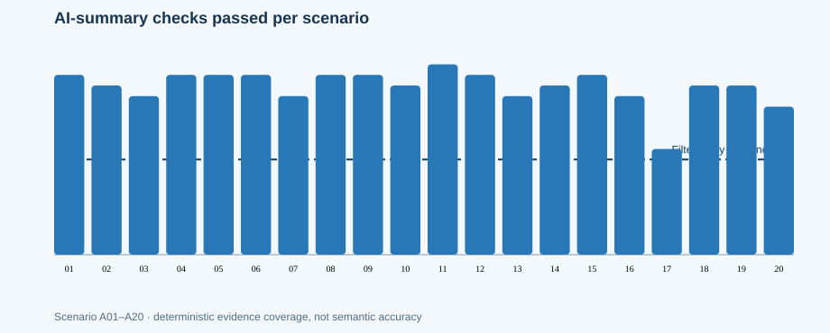

# AI-agent summary benchmark

## What it evaluates

This is the project's one official benchmark. It evaluates whether the existing smolagents agent's generated explanation communicates evidence from its CDC analysis. The same 20-question deterministic checker is applied to 20 distinct filter scenarios. The cases cover all five mental-health questions, locations, demographic groups, year ranges, sparse coverage, and a valid scenario with no numeric estimates. The fixed inputs are in [`benchmark/cases.json`](benchmark/cases.json).

Each question receives pass/fail credit. The questions check the selected question, unit, estimate, filters, years, counts, missingness, annual values, and trend language. The exact criteria and per-question results are in [`evaluation.py`](evaluation.py) and [`benchmark/results.json`](benchmark/results.json). The agent instructions and API source are in [the existing backend repository](https://github.com/Faleeqwesa/530_Midtermproject_FatimaAleem/blob/main/backend/main.py). There is no LLM judge.

The filters-only baseline receives 9/20 for each scenario: it is credited only for information available from the filters and receives no credit for evidence-dependent summary checks. This is the same baseline used by the checker in Streamlit.

## Actual results

The live run was completed November 22, 2026 against the existing Render `/analyze` endpoint. Results and the generated chart are committed alongside the cases.

| Measure | AI-agent summaries | Filters-only baseline |
|---|---:|---:|
| Scenarios | 20 | 20 |
| Checks passed | 319/400 (79.75%) | 180/400 (45%) |
| Mean per scenario | 15.95/20 | 9/20 |
| API response time | Median 10.735s; p95 12.954s; maximum 13.429s | — |

Median, p95, and maximum summarize the response times from this run.



## Examples and lessons

- **Successful summary, A05 (18/20):** For Black, non-Hispanic U.S. adults, the agent reported 15.6% in 2021, 16.6% in 2022, and 16.0% in 2023. The values match the annual values in the recorded agent response.
- **Low-scoring no-value case, A17 (12/20):** Three North Carolina postpartum records had no numeric estimates. The agent correctly explained that no trend could be summarized, while the fixed rubric still expects series-level numeric trends. This is a checker false negative in a no-value scenario.

The results suggest two practical improvements:

1. Prompt the agent to explicitly name the number of comparison series and shared years. A05 reported its annual values but omitted these details.
2. Human-review sample checks, then revise a future rubric version to mark numeric trend criteria not applicable when estimates are absent. Keep scores from this run tied to the current rubric.

## Limits and reproduction

The deterministic checker looks for evidence in the explanation; it can miss a correct paraphrase or fail to identify a contradiction. Expected facts come from the agent's structured response, so this benchmark evaluates explanation quality, not independent CDC source accuracy. Results measure these 20 cases and do not establish clinical accuracy, safety, or health outcomes.

Install the dependencies and run the non-network preflight:

```bash
python -m pip install -r requirements.txt
python benchmark/run.py --dry-run
```

Run the 20 scenarios against the existing Render API to generate a fresh result file and chart:

```bash
python benchmark/run.py
```

Each completed response is saved as the run proceeds. Review the question-level results in [`benchmark/results.json`](benchmark/results.json). The Streamlit app also offers the same optional 20-question check for one generated summary; this portfolio presents only the 20-scenario evaluation above.
